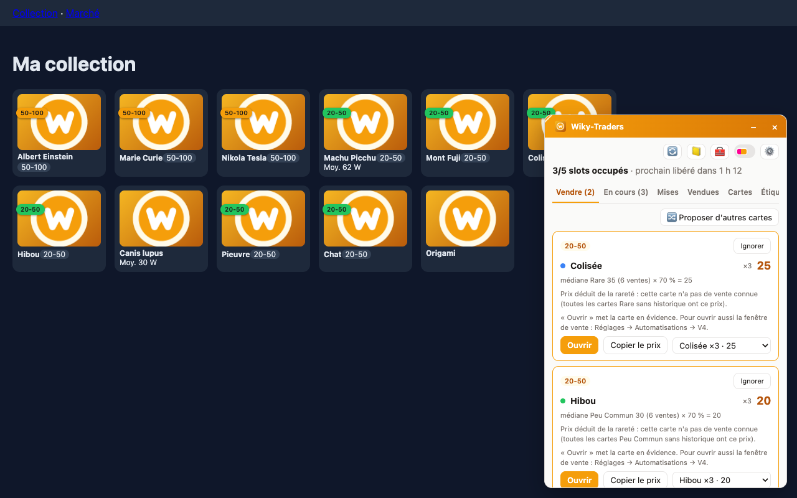
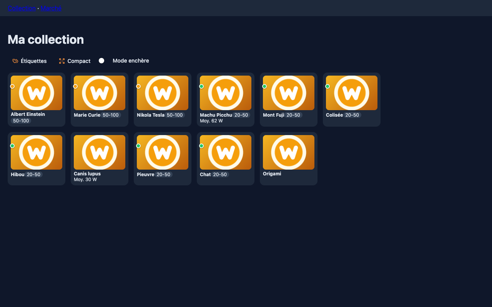
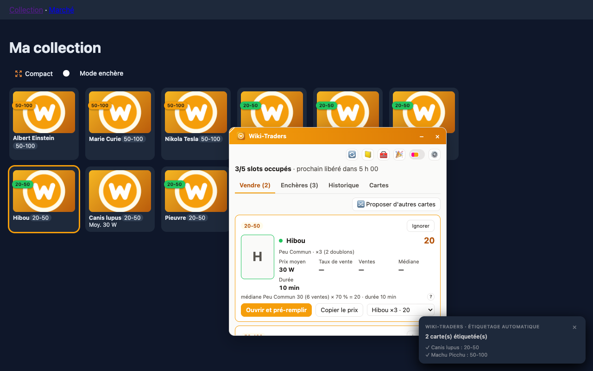

[← Sommaire de la documentation](README.md)

# Étiquettes

Les étiquettes du site (ex. `20-50`, `50-100`, « Mettre au Enchère ») servent à ranger ta collection. Depuis la 1.0, l'onglet **Réglages → Étiquettes** ne sert qu'à l'**étiquetage automatique** : quelles cartes reçoivent quelle étiquette. La vente se règle à part, dans **Ventes** (voir [Vendre](Vendre.md#quelle-carte-est-proposée-)) : en mode « meilleures cartes », les étiquettes n'y servent qu'à choisir les cartes à vendre.

## Mes étiquettes

Pour chaque étiquette :

- **Plage de prix** (de – à W) : la carte dont le prix moyen est dans la plage reçoit l'étiquette (ex. 62 W → `50-100`).
- **Conditions en plus** (toutes celles remplies doivent être vraies) :

| Condition | Exemple |
| --- | --- |
| Le nom ou la catégorie contient | `pays, nation` : il suffit d'un mot ; accents et majuscules ignorés |
| Taux de vente | de 0 à 15 % (compté à partir du seuil de fiabilité, Ventes → Taux de vente) |

- **« ou »** (bouton **+ Ajouter un « ou »**) : une autre façon d'avoir l'étiquette, avec sa propre plage de prix, son texte et son taux de vente. La plage et les conditions du haut forment le premier groupe ; chaque « ou » en ajoute un. L'étiquette est posée dès qu'**un** groupe est rempli, et retirée seulement si **aucun** ne peut l'être (jamais sur un prix ou un taux de vente inconnu). Un résumé « Posée si : … » s'affiche sous l'étiquette.

| Exemple : étiquette `A` | |
| --- | --- |
| Groupe 1 | plage 10 – 20 W, taux de vente de 90 % |
| ou groupe 2 | plage 20 – 100 W, taux de vente de 70 % |
| Résultat | 15 W à 95 % → `A` ; 50 W à 75 % → `A` ; 15 W à 80 % → pas `A` ; 200 W → pas `A` |

Une étiquette avec des conditions (ou des « ou ») est **indépendante** des plages de prix : la carte France (catégorie Pays, 30 W) reçoit `20-50` **et** `Pays`. Pour étiqueter les cartes d'une **famille**, voir l'onglet [Familles](Familles.md#une-étiquette-par-famille).

## Étiquettes sur les cartes

Réglages → Étiquettes → Sur tes cartes, option **Étiquettes visibles sur les cartes** : sur chaque carte de la collection, les étiquettes s'affichent en haut, aux couleurs choisies sur le site.

- **libellés détaillés** : le nom de chaque étiquette (3 au plus, puis « +n ») ;
- **pastilles de couleur seulement** : de simples ronds, le nom au survol.

L'interrupteur à côté de ⚙️ dans la popup bascule entre les deux.

| Libellés | Pastilles |
| --- | --- |
|  |  |

## Étiquetage automatique

> ⚠️ Facultatif et désactivé par défaut : voir [Automatisations et risques](Automatisations-et-risques.md).

Range chaque carte dans l'étiquette dont la plage contient son prix de référence (ex. 62 → `50-100`), une seule plage par carte. Les étiquettes avec des **conditions**, et celles de tes **familles**, s'ajoutent en plus à chaque carte qui y correspond. Une étiquette n'est retirée que si sa règle n'est plus remplie, jamais sur un prix ou un taux de vente inconnu.

1. Réglages → Étiquettes → **Étiquetage automatique** (confirmation).
2. Options : **Retirer les autres étiquettes suivies** (une carte ne garde qu'une plage ; une carte qui quitte une famille perd son étiquette), **Retirer les étiquettes des cartes sans prix connu**.
3. **Lancement** :
   - **À la demande** (défaut) : popup → **Cartes → Étiquetage**, ou bouton **Étiquettes** sur ta collection (à côté de « Plus chères ») ; la liste des changements prévus (carte → étiquette) s'affiche, avec pourquoi certaines cartes sont écartées, puis **Lancer**. Un toast affiche la progression avec un bouton **Arrêter**.
   - **En continu** : l'étiquetage tourne tout seul tant qu'un onglet du site est ouvert (voir ci-dessous).
4. Écritures :
   - par l'**interface** (sur la collection, lancement à la demande seulement) : l'extension ouvre chaque carte et clique dans le menu des étiquettes ;
   - par l'**API** (niveau d'accès *Lecture et étiquettes*, plus fiable, depuis n'importe quelle page) : les mêmes écritures que la sélection multiple du site, limitées aux étiquettes.

Les favoris sont revérifiés avant chaque écriture ; l'étiquetage s'arrête seul si l'interface n'est pas reconnue.

### En continu

*Nécessite l'étiquetage par l'API.* Au lieu d'attendre que tu le lances, l'étiquetage passe tout seul :

- peu après un changement de ta collection ou de tes réglages, et environ 15 s après l'ouverture d'un paquet ;
- sinon toutes les 10 minutes ;
- au plus une fois toutes les 2 minutes, par lots de 40 cartes (le reste au passage suivant) ;
- seulement les cartes à changer : rien à faire, aucune écriture. La collection n'est relue que si elle date de plus de 10 minutes, les prix viennent du cache ;
- un seul onglet étiquette à la fois.

Un message liste les cartes étiquetées. Dans la popup, une pastille « en continu » s'affiche et le bouton devient **Maintenant**.

## Étiquettes des invendues

Le site retire les étiquettes d'une carte mise en vente : si l'enchère se termine **sans acheteur**, la carte revenait en collection sans étiquette. Avec l'option **Remettre les étiquettes des invendues** (Réglages → Étiquettes, désactivée par défaut, nécessite l'étiquetage par l'API) :

1. à la mise en vente, l'extension note les étiquettes de la carte (à défaut, l'étiquette du slot proposé) ;
2. à la fin d'une enchère sans mise, la carte entre dans une file ;
3. un onglet du site ouvert vérifie le statut réel de l'enchère (toutes les 30 s) : invendue ou annulée → les étiquettes sont remises et un toast le signale ; vendue → rien. Une carte pas encore revenue est réessayée pendant 24 h.
