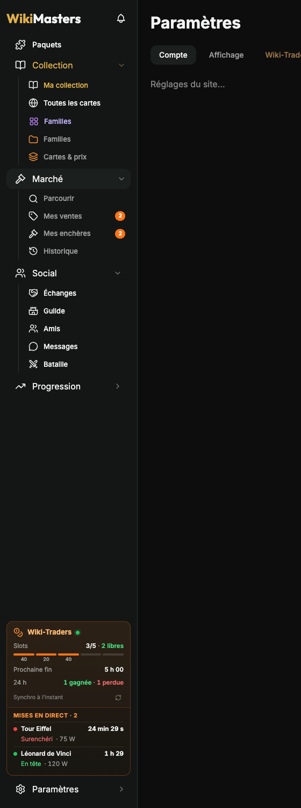

# Wiki-Traders

Copilote d'enchères pour [WikiMasters](https://www.wiki-masters.com) : l'extension garde tes slots d'enchères remplis avec tes meilleures cartes, calcule le bon prix et la bonne durée… et te laisse cliquer. Documentation de la **version 1.0.0**.

## Par où commencer

1. **[Installation](Installation.md)** : construire l'extension et la charger dans ton navigateur (5 minutes).
2. **[Premiers pas](Premiers-pas.md)** : la configuration guidée, étape par étape.
3. **[Vendre](Vendre.md)** : remplir tes slots au bon prix, au quotidien.

## Guides

| Page | Contenu |
| --- | --- |
| [Fonctionnalités](Fonctionnalites.md) | Prix sur les cartes, classement, paquets, échanges, mises… |
| [Familles](Familles.md) | Regrouper des cartes, ajout par sélection multiple, progression, une étiquette par famille, marché des manquantes |
| [Intégration au site](Integration-au-site.md) | Barre latérale compacte, bloc Wiki-Traders, fenêtres, pages, onglet Paramètres |
| [Vendre](Vendre.md) | Slots, meilleures cartes ou par étiquette, paliers de prix, ordre de priorité, fenêtre de vente, Mode enchère |
| [Prix conseillé](Prix-conseille.md) | D'où vient le prix de référence, calcul simple ou avancé, taux de vente, minimum et arrondi |
| [Mises et ventes](Mises-et-ventes.md) | Mes mises, ventes en cours, ventes conclues, journal |
| [Étiquettes](Etiquettes.md) | Plages de prix et conditions, pastilles sur les cartes, étiquetage automatique (à la demande ou en continu) |
| [Référence des réglages](Reglages.md) | Les 7 onglets des réglages, chaque option et sa valeur par défaut |
| [Automatisations et risques](Automatisations-et-risques.md) | Ce que font les options facultatives, et pourquoi elles sont risquées |
| [Dépannage](Depannage.md) | Problèmes courants, diagnostic, FAQ |
| [Développement](Developpement.md) | Construire, tester, contribuer |

## Le principe

Les règles de WikiMasters (section 3) interdisent les bots qui jouent ou échangent à ta place. Par défaut, Wiki-Traders **réfléchit** (quel slot est libre, quelle carte, quel prix) et **tu cliques**. Les options qui agissent sur le site sont désactivées par défaut et demandent une confirmation : voir [Automatisations et risques](Automatisations-et-risques.md).
